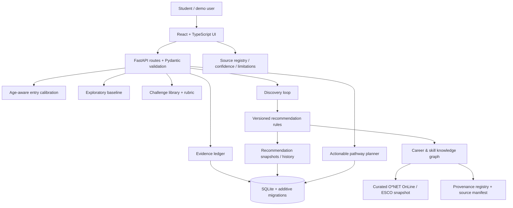

# SkillScope AI — Architecture and Data Flow

## Runtime view

## Main trust boundaries

- **UI → API:** every payload is schema-validated. Selected narrative fields reject obvious direct contact identifiers; this is a limited safeguard, not comprehensive DLP.
- **API → SQLite:** repositories enforce domain validation, foreign keys, consent basis rules, profile-specific record lookups, and deletion cascades. This prototype does not yet authenticate the caller or prove ownership of a profile.
- **Recommendation engine → career facts:** recommendation rules are deterministic and versioned; source facts keep original source/taxonomy identity, provenance, version, geography and quality. Heuristic alignment is not a measured career-fit percentage.
- **Source data → graph:** active snapshots are local, curated extracts. There is no full-source/live-sync claim. A cross-taxonomy relation can remain reviewed-related or unresolved instead of being merged as exact.
- **Synthetic demo fixtures:** every seed fixture is labelled `synthetic_demo`. Demo profiles are not real students and should never be interpreted as outcomes or training labels.

## Longitudinal flow

1. Age band, consent basis and stated goal establish a starting point; age is only one calibration input.
2. A baseline activity and/or short challenge samples a bounded domain.
3. Rubric-specific performance, enjoyment, difficulty, effort, reflection and user interpretation are stored separately.
4. The evidence ledger summarizes coverage and uncertainty without turning absence into zero.
5. The recommendation engine combines current goal, relevant distinct observations, experience/context, source facts and uncertainty. It can preserve alternatives or recommend rediscovery.
6. The next challenge is selected by a deterministic policy. A completed challenge is expected to add evidence and influence the next step; this is covered by the Stage 20 demo test.
7. The source registry and recommendation trace explain the data state, reasoning basis, evidence gaps and limitations.

## Main code areas

- `frontend/src/App.tsx` and `frontend/src/components/`: primary journey, evidence ledger, baseline, challenge loop, recommendations, pathway planner, source registry.
- `backend/app/api/`: HTTP surfaces.
- `backend/app/schemas/`: request/response and validation contracts.
- `backend/app/services/evidence_ledger.py`: profile/evidence persistence and correction/deletion.
- `backend/app/services/discovery_loop.py` and `challenges.py`: next-task policy and rubric-based evidence creation.
- `backend/app/services/recommendations.py`: explainable, versioned recommendations and snapshots.
- `backend/app/services/knowledge_graph.py`, `provenance.py`, `source_registry.py`, `ingestion/`: source-backed graph and source status.
- `backend/app/services/pathway_plans.py`: actionable development plans and history.
- `backend/app/services/database.py`: repeatable SQLite migrations and clearly synthetic demo fixture registry.
- `docs/PRIVACY_AND_SAFETY.md` and `docs/VALIDATION_REPORT.md`: safety boundary, test scope and open release gates.

## Offline behavior

The core user loop can run from the local challenge library and imported curated snapshot without an LLM key or live API. “Offline” here means no live external career-data API is required for this local demo; it does not mean the web application is a service worker/PWA with tested browser offline synchronization.
